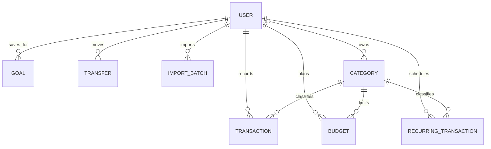
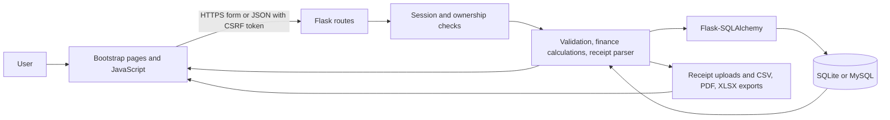

# Aureum system diagrams

## Entity relationship diagram

## Data flow diagram

## Test cases

| Area | Test | Expected result |
|---|---|---|
| Authentication | Register and log in with a strong password | Session starts and dashboard opens |
| Authentication | Submit a POST without a CSRF token | Request is rejected with HTTP 400 |
| Transactions | Create then delete a transaction | Only the signed-in user's row changes |
| Ownership | Submit another user's category ID for a budget | Request is rejected and no budget is saved |
| Budgets | Spend 80% of a category budget | Budget page shows a near-limit alert |
| Recurring | Process an item due today | One dated transaction is created and next date advances |
| Parser | Parse PhonePe/BHIM style receipt text | Amount, payment type, category and confidence are returned |
| Forecast | Regress three increasing monthly totals | Positive slope and next-month projection are calculated |
| Imports | Upload the same mapped CSV twice | Duplicate rows are skipped on the second import |
| Reports | Request PDF, Excel and print versions | Responses use PDF/XLSX formats and the print view renders |
| Deployment config | Normalize a Render PostgreSQL URL | SQLAlchemy uses the installed Psycopg driver |
